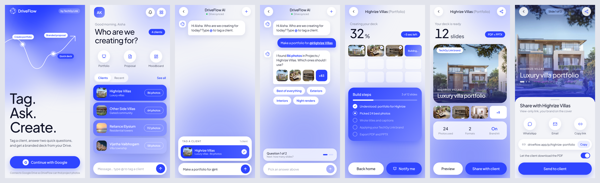

# DriveFlow — mobile app (Light Glow)

The DriveFlow "Light Glow" redesign built as a real cross-platform app:
**Expo SDK 58 · React Native 0.88 · Expo Router · NativeWind 4 · Reanimated 4 · Skia · Gesture Handler 3**.

It runs on **Android, iOS and web** from one codebase.



---

## Run it

The app gets its data from the DriveFlow API in [`../backend`](../backend). Start that first (in the backend folder: `npm install`, `npm run seed`, `npm run dev`). It runs on port 4000.

You need [Node.js 20+](https://nodejs.org) installed. Then, in this folder:

```powershell
npm install
```

```powershell
npx expo start
```

- **On your phone:** install **Expo Go** from the Play Store / App Store and scan the QR code in the terminal (phone and PC on the same Wi-Fi).
- **Android emulator:** press `a` in the terminal. **Web:** press `w`.
- If Expo Go ever reports a native-module version mismatch, make a development build instead:

```powershell
npx expo run:android
```

(For a shareable install, use EAS Build: `npx eas-cli@latest build --profile development`.)

**Where the app finds the API:** in development it uses the same computer that serves the app, on port 4000, so a phone, the emulator and the browser all reach the API on your PC without any setup. For a real build, set `EXPO_PUBLIC_API_URL` (for example `https://api.driveflow.app`).

**Trying it:** "Continue with Google" signs in as the demo account from `npm run seed` (demo@driveflow.local). That account already has Drive connected, 4 clients and 5 decks. You can also create a new account: the 6-digit email code shows in the API's log and at http://localhost:4000/dev/outbox. Connecting Drive then uses the API's sample Drive.

## Screens

Motion is kept deliberate: one signature moment per screen, plus motion that answers your touch. Nothing loops in the background except the welcome glow.

| Route | Screen | What moves |
|---|---|---|
| `/` | 01 Welcome | slow aurora glow (leans toward your finger), the line draws once, the three labels blur in once, headline reveal |
| `/home` | 02 Home | client list fades in; tab indicator slides; content fades out under the floating header and behind the message box; **Recent decks** row (real covers, opened status) |
| `/chat` | 03 Tag a client · 04 AI asks (photos: pick a chip or type e.g. "pool and garden" → slides: 8 / 12 / 15 recommended or type any number 4–40 → **template** → **check the photos**: remove any you don't like with ×, tap a removed one to put it back, min 3, then **Build deck**) | new messages fade in; typing dots; `@` picker appears; chosen chip turns blue |
| `/creating` | 05 Creating | the build itself: slide grid fills, checklist ticks off, % counts up; success haptic, auto-advance |
| `/ready` | 06 Ready | cover tilts in 3D only while you drag it; **Share with client** slides up a share popup (WhatsApp / Email / Copy link, PDF download switch, **Client view**, **Stop sharing** / turn back on); **•••** menu: Edit deck / Download PDF / Share |
| `/preview` | 07 Preview | the deck as PDF pages with a page counter; **•••** menu: Edit deck / Download PDF (a real 16:9 PDF, saved/sent via the system sheet) / Share |
| `/templates` | Templates | 4 deck templates shown with the deck's own slides (cover + 2 inner slides); pick one and **Use**. With `?mode=default` it sets the template new decks start with (Profile → Default template) |
| `/edit-deck` | Edit deck | rename, move up/down and remove slides (min 3); Save shows the edits in Ready, Preview and the PDF; Reset restores the original |
| `/sign-in` | Sign in | email + password (show/hide), validation, forgot password, Google |
| `/sign-up` | Sign up | name, work email, company, password strength meter, terms (Terms / Privacy links open the legal page); then verify email |
| `/verify-email` | Verify email | 6-digit code boxes (paste + SMS/email autofill), resend after 30 s, change email; then Drive setup |
| `/forgot-password` | Forgot password | email a 6-digit reset code → "Check your inbox" → Enter reset code |
| `/reset-password` | Set new password | code + new password (strength meter) + confirm → "Password updated" → back to sign in |
| `/connect-drive` | Connect Google Drive (1/3) | what DriveFlow can and can't access; Connect or Skip |
| `/choose-folder` | Choose projects folder (2/3) | pick the Drive folder with one sub-folder per client |
| `/syncing` | Syncing (3/3) | live progress, then "You're all set" |
| `/notifications` | Notifications | Today / Earlier, unread dots (bell on Home shows a dot), mark all read; each item opens its deck, client or profile |
| `/clients` | All clients | search + filters (Villas, Towers, Communities); tap a client to open it |
| `/client/[id]` | Client details | cover photo, stats, Drive folder, latest photos, past decks; **New deck for …** |
| `/photos` | Photos | the client's Drive photos; from the chat (`mode=pick`) tap to choose, numbers show the order, **Use N photos** answers the chat |
| `/decks` | My decks | 2-column grid of deck covers in each deck's template, type filters, opened / not opened; **•••** → Open, Rename, Client activity, Delete; decks you build in the chat appear here |
| `/activity` | Client activity | opens, time spent, last opened, PDF downloads, time on each slide (most viewed marked) and each visit by device; empty state until the client opens the link (recorded by the API) |
| `/profile` | Profile & settings | account card (→ Account), Google Drive status, Brand kit (→ page), default deck size, notification switches, Help & support, Privacy / Terms, sign out (confirm → welcome) |
| `/account` | Account | edit name and company; sign-in email (read-only); Change password (Google accounts: managed by Google); Delete account |
| `/change-password` | Change password | current + new (strength meter) + confirm → "Password changed" |
| `/delete-account` | Delete account | what gets deleted / what stays (Drive files), type your email to confirm → "Account deleted" → start |
| `/brand-kit` | Brand kit | live cover preview, brand on/off, brand name (defaults to your company), 6 accent colours; applies to Ready, Preview, the PDF, the build steps and the client view |
| `/help` | Help & support | common questions (expand/collapse), "Report a problem" form with optional device details, Terms / Privacy |
| `/p/[slug]` | Client view | what the client sees from the share link (`driveflow.app/p/<share code>`): brand, "Prepared for …", slides, Download PDF (if allowed), Contact the sender; "no longer active" after Stop sharing; "Link not found" for bad links |
| crash | Something went wrong (`ErrorBoundary` in `_layout.tsx`) | friendly screen with Try again / Go to start instead of a blank or red screen |
| `/legal` | Terms & Privacy | one page with a Terms / Privacy switch (`?doc=terms\|privacy`); plain-language **drafts** — have them reviewed and fill the [placeholders] before launch |
| any bad link | Page not found (`+not-found.tsx`) | friendly 404 with Go to home (or start, if signed out) and Go back |

Every press has a light spring and a matching haptic.

## Deck templates

| Template | Look |
|---|---|
| Classic | full photo, soft blue fade, white title at the bottom (the original look) |
| Editorial | white frame, photo on top, magazine-style title and page number underneath |
| Split | text panel on the left (big page number, accent bar, title), photo on the right |
| Bold | photo on top, a band in the brand colour with the title |

You choose one in the chat (third question), and can switch any time from Ready (**Template** stat or **••• → Change template**). Templates use the Brand kit colour and name. Each layout is drawn twice, kept in step: `src/components/SlideView.tsx` (in the app) and `src/lib/deckPdf.ts` (the PDF, same 320 × 180 grid at 3×).

## Where things live

```
src/
  app/                 Expo Router screens (every file is a route)
    _layout.tsx        fonts, splash, gesture root, screen transitions
    index.tsx home.tsx chat.tsx creating.tsx ready.tsx preview.tsx
    notifications.tsx clients.tsx client/[id].tsx photos.tsx decks.tsx edit-deck.tsx profile.tsx legal.tsx
    sign-in.tsx sign-up.tsx verify-email.tsx forgot-password.tsx reset-password.tsx
    connect-drive.tsx choose-folder.tsx syncing.tsx +not-found.tsx
    account.tsx change-password.tsx delete-account.tsx brand-kit.tsx help.tsx p/[slug].tsx
  components/
    glow/              Skia aurora (GlowBackground.tsx) + web version (.web.tsx)
    chat/              Bubbles, Chip, Composer, MentionSheet
    ui/                PressableScale, Button (pill / icon / round), Toggle, Toast, Glass, TopBar
    FlowLine  KineticHeadline  ClientCard  SlideGrid  StepsCard  TiltCard  ShareSheet  DeckMenu  PageShell
    SlideView          one slide in any template (chat cards, picker, Ready cover, Preview, client view)
    FadeEdges          soft top/bottom (or side) fade on every scroll area, so content never ends at a hard line
                       (native: @react-native-masked-view/masked-view; web: CSS mask in FadeEdges.web.tsx)
  lib/deckPdf.ts       builds the deck PDF (expo-print) and opens the save/share sheet (expo-sharing)
  theme/
    tokens.ts          colours, gradients, radii, spacing, shadows  ← brand lives here
    motion.ts          springs, durations, easings, stagger, entering presets
    interop.ts         lets NativeWind className work on Reanimated views
  hooks/               haptics (safe no-op on web), useLoop (reduced-motion aware clock), useCountdown (resend timers)
  api/                 client.ts (fetch + errors + sign-in token), config.ts (API address), tokenStore.ts
                       (token in the device keychain / localStorage on web), types.ts (API shapes)
  data/clients.ts      clients + photos from the API (each photo is an expo-image source with a signed URL)
  data/app.ts          decks and notifications from the API (create, rename, delete, read state)
  data/settings.ts     Profile settings, saved to the account
  data/workspace.ts    loadWorkspace() after sign-in; resetWorkspace() on sign-out / delete account
  data/session.ts      signed-in user + Google Drive state
  data/deckEdits.ts    each deck's slides from the API; useDeckSlides() is what every screen shows (cover = deck name)
  data/photoPick.ts    hands the photo picker's choice back to the chat
  data/brand.ts        brand kit (on/off, name, accent colour), saved to the account
  data/templates.ts    the 4 deck templates; the default and each deck's choice are saved via the API
  data/sharing.ts      per-deck share link (on/off, PDF download allowed, new link), saved via the API
  services/            auth.ts, drive.ts, account.ts, support.ts: the API calls the screens use
assets/images/         villa photos and DriveFlow logos
```

**Change the look:** edit `src/theme/tokens.ts` **and** the matching colours in `tailwind.config.js`.
**Change the feel:** edit `src/theme/motion.ts` (one place for every spring and timing).

### Libraries and what each is used for

| Library | Used for |
|---|---|
| Reanimated 4 + Worklets | every animation, on the UI thread at 60/120 fps; `scheduleOnRN` to call back into JS |
| Gesture Handler 3 (hook API) | tilt card, bottom sheet, touch-reactive aurora |
| React Native Skia | the blurred, drifting, breathing glow blobs |
| Expo Linear Gradient | client cards, steps card, photo overlays |
| Expo Blur | glass top bar / frosted header (iOS + web; frosted white on Android) |
| Expo Haptics | haptics synced to interactions |
| React Native SVG | the self-drawing flow line |
| NativeWind 4 | Tailwind classes for layout and type |
| Lucide | icons |
| Expo Image, Clipboard, Router, Font, Splash Screen | images, copy link, navigation, Plus Jakarta Sans, splash |
| Expo Print, Sharing, File System, Asset | Download PDF: render the deck to PDF, save it, open the system save/share sheet |

Not added on purpose (to keep the app lean): Moti, Redash, Rive, Lottie, Shadow 2. Reanimated covers Moti and Redash, and React Native 0.88 has native `boxShadow`. Rive and Lottie only make sense once you have `.riv` / `.json` animation files; drop them in later if a designer makes some.

## Quality checks (all passing)

```powershell
npm run typecheck
```

```powershell
npm run lint
```

```powershell
npm run doctor
```

- TypeScript strict: 0 errors. ESLint (Expo + React Compiler rules): 0 problems. `expo-doctor`: 20/20.
- `npx expo export` bundles cleanly for **Android, iOS and web**.
- The web build was run through the whole flow (welcome → tag → both questions → build → ready → share → copy link) with **0 console errors or warnings**.
- Tested on an **Android 16 emulator (Pixel 10 Pro)**: the full flow (welcome, home, @tag, both questions, build, ready, share) runs and matches the design. The added pages were also run on it: sign up → Terms/Privacy → verify email (wrong and right code) → Drive setup; client details, photos, the photo picker (picked photos become the slides); edit deck (rename, move, remove → Ready/Preview/PDF); forgot → reset code → new password → sign in; and a bad link → page not found. Screenshots: `docs/android-preview.png`. Not yet tested on a physical phone or on iOS.

## Accessibility and motion

- Honours the OS **Reduce motion** setting: entrances are skipped and the welcome glow stays still.
- Real buttons, tabs, radios and switches with labels; decorative layers are hidden from screen readers.
- Text sizes and touch targets follow the design (44 px+ hit areas).

## Security notes

- The app only talks to the DriveFlow API. No API keys, analytics or secrets are in the code. The sign-in token is kept in the device keychain (expo-secure-store), or in localStorage on web.
- Photo URLs carry a signature that expires after a day or two, so images load without the token and links can't be reused for long.
- Route params are validated (`getClient`, `parseSlides`) so a bad deep link can't crash a screen. Message input is length-limited.
- Sharing uses the system share sheet / `mailto:` / clipboard only. The PDF is built on the phone from the deck's photos (nothing is uploaded).
- `npm audit` lists advisories in `picomatch` / `minimatch`. They are **build-time tooling only** (Metro, Tailwind, Babel); they are not in the app bundles (verified), and there is no patched `picomatch` release yet. Don't run `npm audit fix --force`: it would break the Expo SDK versions.

## Connected to the API (and what's next for production)

- **All data comes from the DriveFlow API** (`../backend`). That covers:
  - accounts, sign-in that survives a restart, Drive connect, folder choice and sync;
  - clients and photos;
  - decks, which the server builds, plus renames, Edit deck, templates and share links;
  - client activity, notifications, settings, the brand kit and Help feedback.
- **Real Google sign-in and Google Drive** still use the API's development stand-ins:
  - "Continue with Google" sends a development token (`DEV_GOOGLE_EMAIL` in `src/api/config.ts`).
  - Connecting Drive sends `{ mock: true }`.
  - To go live, use `expo-auth-session` with your Google OAuth client IDs. Send the ID token to `POST /auth/google`, and the authorization code (with the `drive.readonly` scope and offline access) to `POST /drive/connect`. Then turn `DEV_MOCKS` off on the server. The screens don't change: only `src/services/auth.ts` and `src/services/drive.ts` do.
- **AI replies** in the chat are still scripted on the phone. The deck itself is built by the API.
- **Photo labels** (exterior / interior / night) come from each photo's file name or its Drive description on the server. They can be fixed by hand with `PATCH /photos/:id`. If a folder has too few of a kind, the assistant tops up with the client's other photos and says so.
- **Share links** point to `https://driveflow.app/p/<share code>`. The API issues the codes, and `/p/[slug]` loads the deck from the public API without sign-in and records each visit.
  - `app.json` declares iOS associated domains and an Android app link for `driveflow.app/p/*`. They start working once that domain serves the `apple-app-site-association` and `assetlinks.json` files.
  - For clients without the app, host the web build (`npx expo export -p web`) on that domain, with `EXPO_PUBLIC_API_URL` pointing at the API.
- **Terms & Privacy** text in `src/app/legal.tsx` is a plain-language draft, not legal advice: have it reviewed and replace the [placeholders] (support email, company details, governing law).
- **Font:** the redesign mock-ups used Lufga (commercial). The app ships **Plus Jakarta Sans** (free, open licence, the original DriveFlow font). To use Lufga, add your licensed font files and change `fonts` in `tokens.ts` and `tailwind.config.js`.
- **App icon:** still the Expo default. Replace `assets/icon.png` and the `android-icon-*.png` files with the DriveFlow icon (1024×1024).
